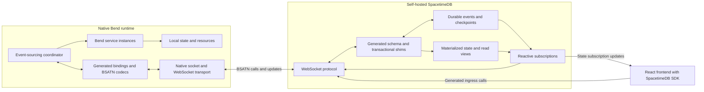
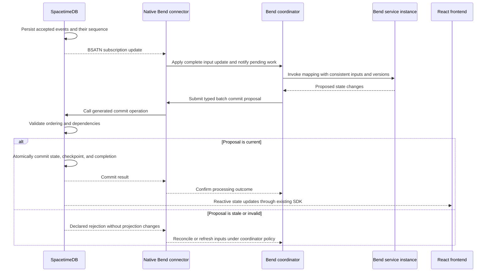
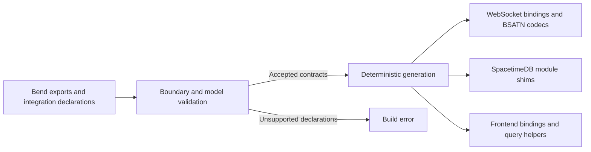

# Desired Confluxion architecture 1

This document defines the desired architecture, its vocabulary, and its decisions. It does not describe an implemented connector or prescribe implementation steps.

The [desired BendFlow architecture](architecture.md) provides the automatic service-generation model. The [SpacetimeDB feasibility report](spacetime-bend.md) records the runtime constraints. The [CQRS integration assessment](spacetime-bend-cqrs.md) describes the reusable database, client, and CLI capabilities.

## Purpose

Confluxion lets you develop application behavior in native Bend and generate its SpacetimeDB integration from explicit Bend declarations. A build produces WebSocket service bindings, BSATN contracts, transactional module shims, and frontend bindings. The external interface requires no second handwritten definition of the service's inputs and outputs.

The generated WebSocket integration connects native BendRT to self-hosted SpacetimeDB. This connection serves database calls and subscriptions. It does not expose a Bend WebSocket server to frontends or connect Bend to arbitrary external services.

Bend defines business behavior and the CQRS coordination model. SpacetimeDB persists event history and materialized state, executes transactional shims, and pushes subscribed state changes to frontends. React uses SpacetimeDB's existing client directly.

## Vocabulary

| Term | Meaning |
| --- | --- |
| WebSocket endpoint | A generated logical service binding over the Bend–SpacetimeDB connection, with declared input, output, and failure contracts. |
| Bend service, or service | An explicitly exported Bend definition selected for generation. It owns the corresponding computation or projection behavior. |
| Native connector | The Bend-owned transport and protocol component that connects to SpacetimeDB, sends calls, and receives replies and subscription updates. |
| Module shim | Generated SpacetimeDB code that defines schema and executes authorization, dependency checks, and atomic database operations. |
| Coordinator | Bend code that owns ordered processing, batching, retries, recovery, and dispatch to service instances. |
| Stream or partition | A declared ordering and state-ownership scope. Independent scopes can progress independently. |
| Service instance | The Bend execution context for a declared service and processing scope. |
| Event history | Retained accepted domain events that form the application's authoritative history. |
| Materialized state | Persisted projections of event history, including state exposed to the frontend. |
| Transition | Acceptance of an event-to-state proposal, including its complete state changes and processing checkpoint, in one database transaction. |
| Contract | The observable schema, operation identity, result, failure, and compatibility rules of a generated binding. |
| BSATN Wire Data | Concrete boundary values with a supported representation in SpacetimeDB's BSATN Data Format. Every nested field follows the same rule. |

A logical endpoint is not a separate socket or URL for each service. Bindings use SpacetimeDB's shared WebSocket protocol and identify the appropriate calls and subscriptions within it. A connection identity is not a stream identity or application state.

## Runtime architecture

The native connector owns the Bend–SpacetimeDB protocol session. It decodes subscribed inputs, correlates call results, and supplies complete transaction updates to the coordinator. The coordinator selects the service and processing scope, obtains consistent inputs, and invokes Bend computation.

Bend computes a proposal without holding a database transaction open. A generated module operation validates the proposal against current state and commits its effects atomically. SpacetimeDB then supplies the frontend's matching subscription updates without a Bend relay.

The frontend's existing SDK connection is separate from the native Bend connector. The native transport described here has only SpacetimeDB as its peer.

## One generated binding identifies one Bend service

Each declared service has one deterministic binding and one set of BSATN contracts. The coordinator does not choose an unrelated business function at request time. Ordinary helpers do not become endpoints implicitly.

A binding associates the service with its input subscriptions and database operation contracts. Several generated schema and lifecycle operations can support that binding. Those operations do not introduce handwritten business behavior in the module.

Service definitions identify behavior. Stream or partition identities select processing instances. Several bindings can share the connector without sharing application ordering. This relationship does not prescribe an executable or process for every endpoint.

## Bend owns coordination; SpacetimeDB owns durable commits

Bend owns command decisions, event evolution, projection algorithms, batching, worker scheduling, and local resource lifecycles. The coordinator manages retry reconciliation and recovery from durable checkpoints.

SpacetimeDB owns persisted event rows, materialized state, indexes, and transactional execution. Generated shims check authorization, expected checkpoints, dependency versions, operation identities, and any worker fencing conditions. These checks execute in the same transaction as the resulting writes.

Event history is authoritative history. The event-to-state transaction is the authoritative transition. Materialized state and Bend's local copies can be reconstructed under the declared replay policy. A transaction is an operation, so its accepted effects and processing position require durable representation.

Pending commands are distinct from accepted domain events. An ingress acknowledgement means acceptance at that boundary. It does not establish completion of the Bend business operation. Generated outcome and checkpoint read models let the frontend observe completion.

Bend's dependent and affine types can describe internal state relationships. BSATN contracts describe concrete transmitted values. A type-correct proposal still requires atomic freshness checks against the database.

## Processing is ordered within a declared scope

The coordinator advances each dependent stream or partition according to its event sequence and committed checkpoint. Independent partitions can progress concurrently, and an individual mapping can use native Bend parallelism.

WebSocket arrival order and database commit order do not establish application event order. A generated commit operation accepts only a valid next event range against the expected state. Competing or stale proposals fail without advancing that range.

One event can produce several state changes. A batch can process several events. The complete state changes, checkpoint advancement, and completion record commit together in one bounded transaction. Batch formation, queue limits, and failed-event handling follow declared coordinator policies.

### Event-to-state sequence

No transaction spans the external mapping computation. Accepted events can wait before their projected state becomes visible. Frontend subscription readiness and projection progress are separate concepts.

## Contracts come from the Bend boundary and use BSATN

Explicit Bend exports and integration declarations define service contracts, table schemas, processing scope, dependencies, and read models. The generator derives module registrations, native bindings, codecs, and frontend query helpers from those declarations.

BSATN is the data representation inside the supported SpacetimeDB protocol envelopes. It does not replace WebSocket framing, authentication, request correlation, compression handling, or subscription semantics. The native connector and generated module must agree on the deployed schema and protocol version.

Eligible boundary values include supported scalars, records, variants, and collections with a complete representation and bounded transfer policy. Dependent types, erased proofs, functions, closures, IO computations, and opaque runtime resources do not cross directly. Runtime identities, tags, revisions, and checkpoints cross as explicit data.

Internal Bend helpers, retained state, and resources can use richer dependent and affine types. The generator rejects unsupported boundary declarations before producing deployable bindings. A Data declaration alone does not establish BSATN compatibility.

Subscription helpers come from explicit read-model and visibility declarations. The generator does not infer authorization or mutable database dependencies from arbitrary business code. The frontend uses the standard SpacetimeDB client to execute the generated queries and maintain its cache.

Generation is deterministic for the same declarations, policies, and generator version. It does not guarantee compatibility after a schema or behavior change.

## Low-level transport is a required component

Current Bend has no WebSocket library. This architecture requires new low-level socket and WebSocket code for the native connector, together with the required native networking integration.

The transport covers connection establishment, WebSocket framing, control messages, closure, and the networking services required by the configured deployment. The protocol layer covers SpacetimeDB negotiation, authentication, BSATN messages, compression, subscriptions, and request correlation. Generated codecs handle application values.

This transport connects Bend to SpacetimeDB only. It is not a general external-service client or a public endpoint server. Its lifecycle belongs to the Bend coordinator rather than a Node controller.

## Build and publish are generated from Bend

You can write Bend code, configure one build/publish script, and have it automatically generate, build, and publish the SpacetimeDB module and frontend bindings.

Bend source includes the explicit persistence and query declarations needed for generation. Routine service changes require no separate manual table, reducer, or subscription registration and no hand-maintained module implementation.

The build produces the native Bend application, generated module artifacts, and frontend bindings. The publish script uses the standard SpacetimeDB tools for its module and deploys the native Bend worker beside the self-hosted database. Publishing the module alone does not deploy BendRT.

Deployment targets, credentials, and process supervision are configured once. Changes to accepted event formats, projection semantics, or persisted schemas require an explicit migration or rebuild policy that the script can execute.

## Closure, failure, and recovery

Connection loss does not prove that a submitted transaction failed. The coordinator reconciles uncertain outcomes through durable operation identities and checkpoints before resuming processing.

Subscriptions notify Bend of pending work and replicate current query state. Durable events and checkpoints provide recovery. A reconnect snapshot does not replay every intermediate offline notification.

Worker shutdown stops new work admission and lets active computation or commit settle within its lifecycle policy. Durable pending work remains recoverable after forced termination. Repeated computation is possible, while conditional commits and completion records prevent duplicate accepted projection effects.

Local Bend state is adopted or refreshed according to confirmed commit outcomes. Database commits are not atomic with Bend memory or arbitrary external effects. Claims or leases require commit-time fencing checks so an old worker cannot publish after ownership changes.

## Decisions and limitations

- Explicit Bend declarations define generated service bindings and concrete BSATN contracts.
- The native WebSocket connection is between BendRT and SpacetimeDB, with no Node endpoint controller or database payload bridge.
- The frontend connects directly to SpacetimeDB through its existing client and reactive subscriptions.
- Bend owns business logic and event-sourcing coordination. Generated module operations own atomic validation and persistence.
- Ordering is explicit per stream or partition. Connection order and affine use do not establish durable event ordering or exactly-once execution.
- Native computation occurs outside the database transaction. Conditional commit supplies projection safety against current state.
- The event log is authoritative history, and the event-to-state commit is the authoritative transition.
- Supported types, message sizes, queues, and transaction bounds are part of the generated contracts and runtime policies.
- Native WebSocket transport, BSATN bindings, coordinator integration, and automatic shim generation remain to be implemented.

Exact declaration syntax, code-generation layouts, socket APIs, numeric limits, protocol versions, and deployment packaging belong to implementation plans.
